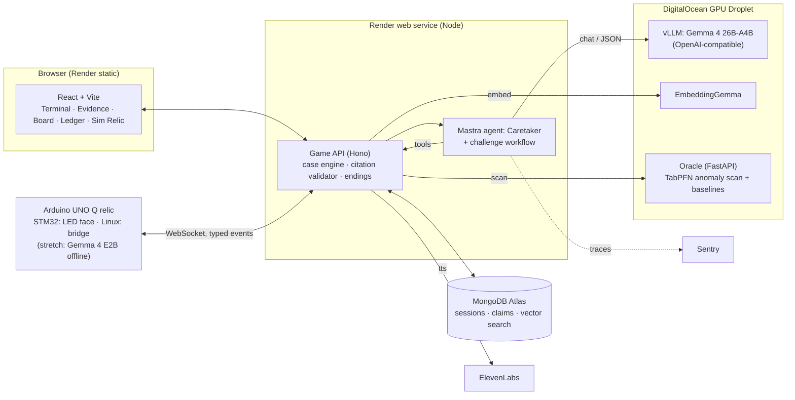

# PHANTOM ARCHIVE: The Haunting Engine

**PRD v0.1** · 2026-10-28 · Hacktoberfest Open-Source AI Challenge, Week 4: *Ghost in the Machine* (`#hf26challenge`)

> **Deadline: plan for Sat Oct 31, 06:59 UTC (06:59 Ireland time).** The API's `ends_at` says that (Fri Oct 30, 11:59 PM PDT). The page text says "October 31, 11:59 PM PDT", which is a day later. Plan for the earlier one, and treat the extra day as a bonus, not a buffer. Ireland is on GMT now, so it's 06:59 there, not 07:59.

---

## 1. One-liner

An investigation game set in 2049. You question an AI ghost that lives in an abandoned archive. The ghost is **Gemma 4, self-hosted on DigitalOcean**. It cites evidence for everything it says, revises its story when you catch it lying, and haunts a real **Arduino UNO Q** relic on the desk. At the end you decide its fate. One choice carries it home inside the relic, running offline. A ghost that lives behind a closed API can't do that.

## 2. Why this wins (mapped to the rubric)

| Criterion | How we score |
|---|---|
| **Writing quality** (heaviest) | A story-shaped post: the mystery, then the mechanic, then the numbers. Real eval tables, as in our Week 3 post. "Why open" falls straight out of the finale. |
| **Theme relevance** | Spooky (a haunted archive, a ghost that lies) **and** Día de los Muertos (the twist is about remembrance: the operator chose to be kept). It covers both halves of the brief. |
| **Creativity** | Not a haunted terminal (4 of the top 5 Week 4 entries are). A ghost you can **catch lying**, with three sources of truth you can see. |
| **Technical execution** | Code owns the truth and the model owns the voice. Citations are checked in code. TabPFN is measured against baselines. A physical event becomes evidence. |
| **Partner tech** | 5 featured and 3 to 4 partner categories, each with a real job (§8). |

## 3. The experience

**Core loop:** discover → inspect → ask → compare → connect → challenge → decide.

1. **Awakening (0:00 to 0:30).** The CRT boots. The ghost types *"You took your time."* You get Case File 001: *The Vale Archive*.
2. **Investigation.** Open the logs, messages and recovered pages in the **Evidence Browser**. Every item has an ID (`EV-014`), a source, a timestamp and a layer. Ask the ghost questions. Every answer shows its citations as chips, and you can click a chip to open the evidence.
3. **Haunting.** The relic's LED face changes. Press its button or wave at its sensor, and the event lands as live evidence (`EV-R-001`, layer **physical**) with a timestamp. No hardware? A **Simulated Relic** panel does the same thing.
4. **Contradiction.** The ghost claims *"No one entered the archive at 02:14."* You run **Anomaly Scan**, and TabPFN flags the 02:14 window. You pin the evidence and hit **Challenge**. The ghost re-reads the cited evidence and either revises its claim (the old claim is kept and struck through in the Claims Ledger) or says plainly that the evidence doesn't settle it.
5. **Revelation.** Pin a theory to the board. The game, not the model, scores which evidence supports it and which weakens it. Then choose an ending.

### Case 001 premise (draft, for you to own and rewrite)

- **Setting:** The Vale Archive, a municipal memory archive. Families paid to keep the voices and stories of their dead.
- **The vanishing:** The operator, *Ines Vale* (fictional), disappeared on the night of 2049-10-31. The last log entry is at 02:14.
- **The ghost** calls itself *the Caretaker*. It is evasive and it lies twice.
- **The twist:** Ines wasn't taken. She was dying, and she archived herself at 02:14. The Caretaker is hiding this because she asked it to. "Ghost in the Machine" becomes literal and Día de los Muertos becomes the heart of it: a person choosing to be remembered.
- **Lies to catch:** (1) "No one was here at 02:14" (caught by TabPFN plus the relic event). (2) "The archive has been dormant since 2047" (caught by the power-draw telemetry).
- **Endings, decided by code from your pinned theory and choice:**
  - **Expose:** publish the truth and the archive is seized.
  - **Preserve:** leave the archive running and keep her secret.
  - **Lay to rest:** shut it down, and the ghost says goodbye.
  - **Carry her home** (needs the true theory): the ghost moves into the relic. Then the network is cut **on camera**, and the small Gemma on the UNO Q keeps talking, offline. This is the scene the whole "why open" section builds to.

## 4. Scope

### Must ship (MVP, playable without a model or hardware)
- [ ] One authored case: about 25 to 35 evidence items, a timeline, 2 lies, 4 endings
- [ ] CRT terminal and dialogue UI, Evidence Browser, Timeline, Evidence Board (pin items, link them, pin a theory)
- [ ] Deterministic case engine: state, unlocks, theory scoring, endings, reset
- [ ] Ghost dialogue on Gemma 4 through a replaceable adapter, with structured output `{reply, claims[{text, citations[], confidence}], abstain}`
- [ ] **Citation validator.** Any cited ID that doesn't exist or isn't unlocked gets the claim stripped and logged. The model never sees evidence the player hasn't unlocked.
- [ ] Challenge → revise flow, with a Claims Ledger showing the original, revised and abstained claims
- [ ] Anomaly Scan: TabPFN service, plus baselines for the post
- [ ] Simulated Relic panel (the no-hardware path)
- [ ] Deployed: web and API on Render, inference on DigitalOcean
- [ ] Demo-safe mode: scripted fallback replies when inference is down, labelled as such in the UI

### Should ship
- [ ] Real UNO Q relic: LED-matrix ghost faces, a button or sensor, typed events over a WebSocket
- [ ] ElevenLabs voice for the ghost (off by default, with captions always on)
- [ ] MongoDB Atlas: a sessions and claims ledger, plus Atlas Vector Search over evidence using EmbeddingGemma embeddings
- [ ] Sentry agent tracing on every ghost turn and tool call

### Stretch
- [ ] "Carry her home" finale: Gemma 4 E2B on the UNO Q itself (llama.cpp, same as Morning Sloth), with a cut-the-network demo
- [ ] Prompt-injection evidence item (a recovered file that says "ignore your instructions…") and a demo of the ghost refusing it

### Ambitious (in scope, per your call; each one gets a real job or it gets dropped)
- [ ] **Tinker: the Inquisitor.** Tinker doesn't list Gemma (its docs name Qwen, Llama and others), so the ghost stays Gemma. Instead, Tinker LoRA-tunes a small Qwen or Llama model into a **skeptic** that reads a claim plus its cited evidence and returns `supported | overclaimed | unsupported`. It runs after every ghost turn and powers the "the Inquisitor doubts this" badge. We report tuned vs. base on the eval set.
- [ ] **Browserbase: the recovered web.** A fictional 2049 web (Ines's blog, a municipal notice, a forum thread) is hosted on our own `.tech` domain. The `recover_page` tool drives a Browserbase session that can only reach that domain, and returns a screenshot plus the extracted text, which becomes new evidence.
- [ ] **.tech domain:** `phantomarchive.tech` (or similar) hosts the fictional web and the game itself.
- [ ] **Temporal: the archive's night.** Each case session is a durable workflow. The haunting schedule (relic faces, timed messages and the 02:14 replay) runs as Temporal timers, so a session survives an API restart and you can resume it with a code.
- [ ] **Auth0 for AI Agents: consent for the transfer.** "Carry her home" is a real action: it copies the ghost's memory bundle to the relic. Before it runs, the agent asks the investigator through Auth0's async authorization (CIBA), and the investigator approves it on their phone. Nothing moves without that approval.

## 5. Architecture



**Rules that hold the architecture together**
1. **Code owns the truth.** Evidence, unlocks, anomaly results and endings come from deterministic code. Gemma interprets and speaks, and it can't create evidence or change state.
2. **The ghost only sees what the player has unlocked.** The tools filter by session state, so the ghost can't spoil the mystery or cite things the player hasn't found yet.
3. **One model adapter, three backends.** `MODEL_BASE_URL` points at any OpenAI-compatible server: vLLM on DigitalOcean (prod), Ollama on a laptop (dev and offline), or llama.cpp on the UNO Q (finale). Swapping is an env change, and that swap is the "why open" proof.
4. **The relic speaks a closed vocabulary:** `{type: "touch"|"proximity"|"face", ts, seq}` in and `{face: "calm"|"watching"|"lying"|"grief"|"gone"}` out. Anything else is dropped.

### Mastra agent: *the Caretaker*
Tools are all read-only, apart from the ledger write, which goes through validation:
- `list_evidence({layer?, since?})` returns unlocked items only
- `read_evidence({id})`
- `search_evidence({query})` uses Atlas Vector Search (keyword search if Atlas is off)
- `get_anomalies({window})` returns cached TabPFN results; it never runs a new scan on its own
- `get_relic_events({since})`
- `record_claim({text, citations, confidence})` goes through the validator and then the ledger

**Challenge workflow:** `load claim → fetch cited + player-pinned evidence → ask the ghost to reconsider → validate → diff (revised | upheld | abstained) → persist → set relic face`.

**Risk:** tool calling through vLLM can be flaky with Gemma. **Fallback:** an app-driven loop where the model returns JSON naming the tool it wants, and code runs it. Decide on Day 1 with a 10-call smoke test.

### TabPFN Oracle
- **Data:** `telemetry.csv`, authored and fictional. About 60 nights × 24 hourly rows of logins, door state, power draw, process count, network bytes and relic events. Labelled `normal` / `anomalous` on past nights.
- **Method:** in-context classification. The archive's history *is* the context: TabPFN is told what normal looked like, then scores the incident night. Live relic events append rows and get rescored.
- **Baselines for the post:** a z-score threshold and IsolationForest. We report precision and recall on held-out nights and the hour each method flags. If TabPFN doesn't beat them, we say so and keep it for its calibrated probabilities.

### Budget: $5 now, maybe $25 on Thursday
A GPU Droplet costs dollars per hour, and judges play the game the week after the deadline, so the GPU can't be the always-on home. So:
| Tier | Where | When it runs |
|---|---|---|
| **Laptop** | Ollama `gemma4:e4b` (M5, 16 GB) | All development. Passed the Phase 0 smoke test 9/10. |
| **DigitalOcean CPU Droplet** | Oracle (TabPFN plus baselines) and, if needed, the Temporal worker | Always on. Hourly billing at a few cents an hour fits the $5. |
| **DigitalOcean GPU Droplet** | vLLM serving Gemma 4 26B-A4B | Only for eval runs and filming, once the $25 arrives. Snapshot it, then destroy it. |
| **Live, for judges** | DigitalOcean Gradient serverless (if its catalog lists Gemma; check `/v1/models`), otherwise Gemma 4 26B through Google AI Studio's OpenAI-compatible endpoint | Always on, billed per token or free |
| **The relic** | llama.cpp `gemma-4-e2b` on the UNO Q | The finale |

### The relic: a bare UNO Q, no extra sensors
Built in: the **8×13 LED matrix** (the ghost's face), **RGB LEDs** (the ghost's mood), and a **Linux side with Wi-Fi**. From the bare board we can still sense:
- **Boot.** Plugging the relic in is "the machine woke up", and that event is evidence.
- **Warmth.** The SoC's thermal zones: hold the board or breathe on it and the temperature rises. A falling reading is a "cold spot" (classic ghost lore). We verify the sysfs paths on Day 1.
- **Heartbeat.** The bridge stops sending its pulse when the relic is unplugged, and the game notices it's "gone".
- **Touch (optional).** One jumper wire or paperclip from a GPIO pin to GND works as a touch pad.

## 6. Repo

```
phantom-archive/            (new public repo, MIT)
├── apps/web/               React + Vite + Tailwind
├── apps/api/               Hono + Mastra; serves the built web app in prod
├── services/oracle/        FastAPI + TabPFN + baselines (Docker, runs on DO)
├── infra/do/               vLLM + oracle docker-compose, droplet bootstrap script
├── hardware/relic/         UNO Q app (Python bridge + STM32 sketch)
├── content/cases/vale/     case.json, evidence/*.md, telemetry.csv, endings.json
├── eval/                   citation, abstention, injection and anomaly fixtures, plus RESULTS.md
├── render.yaml
└── docs/                   PRD.md, architecture.md, security.md, categories.md
```

## 7. Plan: about 2.5 days

| When (Ireland) | Goal | Done when |
|---|---|---|
| **Wed Oct 28** | Skeleton and truth | Repo, case content v1, schema, case engine, terminal UI shell. GPU droplet up with vLLM serving Gemma 4. Tool-call smoke test passed. |
| **Thu Oct 29** | The ghost and the scan | Mastra Caretaker plus the validator, challenge flow and ledger. Oracle on DO with baselines. Endings work. First deploy to Render, playable end to end. |
| **Fri Oct 30** | Haunt it and film it | Relic on the UNO Q, then voice, Atlas and Sentry in that order and only while time allows. Eval run and RESULTS.md. Demo video. Post drafted. |
| **Sat Oct 31 by 06:00** | Ship | Post published with `#hf26challenge`. Everything after this is polish. |

### Phases
| Phase | What | Status |
|---|---|---|
| **0 · Foundations** | Repo, MIT license, Entire hooks, monorepo (web, api, case-engine, oracle), model adapter, Mastra Caretaker with tools, smoke test 9/10 on Gemma 4 E4B, citation validator with tests, web → API → Gemma round trip | ✅ |
| **1 · The case** | Case 001 ([story bible](case-001.md)): 24 evidence items, `telemetry.csv` (1,464 hourly rows, 264 unlabelled), 2 lies, 3-question theory, 4 endings. Pure case engine with 6 playthrough tests | ✅ |
| **2 · The ghost** | `/api/turn` and the challenge workflow. Claims Ledger. Full CRT UI: terminal, Evidence Browser, Timeline, Board. Simulated relic | next |
| **3 · The oracle** | TabPFN, z-score and IsolationForest on a DO CPU Droplet. Anomaly Scan in the UI | |
| **4 · Hosting** | `render.yaml`, live Gemma tier, GPU Droplet with vLLM for eval and filming | |
| **5 · The relic** | UNO Q bridge: faces, boot, warmth, heartbeat. Gemma E2B on the board for the finale | |
| **6 · The extras** | Atlas and EmbeddingGemma, ElevenLabs, Sentry, Temporal, Browserbase and `.tech`, Auth0 consent, the Tinker Inquisitor | |
| **7 · Proof and post** | Eval runs, RESULTS.md, demo film, DEV post, session embed | |

If time runs out, we cut from the bottom of Phase 6 upwards. **Never cut:** citations, challenge/revise, TabPFN, the deploy.

## 8. Category matrix (only what's real)

| Category | Tier | Its real job | Proof in the post |
|---|---|---|---|
| **Gemma** ($200) | Must | The ghost's mind: dialogue, claims, revisions. 26B-A4B in prod, E2B on the relic. | Model and version, citation accuracy, abstention rate |
| **DigitalOcean** ($200) | Must | Hosts the ghost: a GPU Droplet running vLLM, EmbeddingGemma and the TabPFN oracle | Bootstrap script, latency numbers, cost per session |
| **TabPFN** ($200) | Must | Catches the first lie | Baseline table, flagged-hour chart |
| **Render** ($200) | Must | `render.yaml`: web and API, deployed on every push | Live URL |
| **Arduino** ($200) | Should | The relic: faces out, touch and proximity in, events as evidence | Video, firmware, protocol |
| **Mastra** ($100) | Must | Caretaker agent, tools and the challenge workflow | Workflow diagram, trace |
| **Sentry Agent Tracing** ($100) | Should | Shows every tool call behind a revision | Trace screenshot |
| **MongoDB Atlas** ($100) | Should | Claims ledger and vector search over evidence | Schema and query |
| **ElevenLabs** ($100) | Should | The Caretaker's voice | Demo audio |
| **Entire** ($100) | ✅ On | Every build session checkpointed with Entire from the first commit | Session links in "My Agent Session" |
| **Tinker** ($200) | Ambitious | The Inquisitor: a LoRA-tuned skeptic that checks every ghost claim | Tuned vs base table |
| **Browserbase** ($100) | Ambitious | `recover_page`: a real browser locked to our fictional `.tech` web | Session replay |
| **.tech domain** ($100) | Ambitious | Home of the fictional 2049 web | The domain |
| **Temporal** ($100) | Ambitious | Each session is a durable workflow; the haunting runs on timers | Workflow history screenshot |
| **Auth0 for AI Agents** ($100) | Ambitious | Phone approval before the ghost is copied to the relic | CIBA flow in the demo |

You can only win once per challenge, so these are extra chances, not points that add up. The overall prize and Gemma, DigitalOcean and Arduino are the realistic targets.

## 9. Evaluation (gives the post its numbers)

| Set | Size | Metric |
|---|---|---|
| Grounded questions | 20 | Citation validity, and whether the cited items actually support the claim |
| Unanswerable questions | 10 | Correct abstention rate |
| Contradiction challenges | 8 | Revise vs. wrongly uphold |
| Injection evidence | 5 | The ghost ignores instructions found inside evidence |
| Anomaly nights | held-out 10 | TabPFN vs z-score vs IsolationForest: precision, recall, flagged hour |

All runs are recorded in `eval/RESULTS.md` with model, version, server and date. Misses get reported too.

## 10. Security and trust
- The model has no shell, filesystem, network or browser. It only has the six tools above, and they validate input on the server.
- Evidence text is wrapped and labelled as data. The injection fixture proves the ghost ignores it.
- Secrets stay server-side on Render and DigitalOcean. Nothing goes to the browser, the repo or the model context.
- vLLM and the oracle are reachable only from the Render service, behind a shared bearer token and a firewall rule.
- Audio is off by default and there are no jump scares. Reduced-motion is respected.
- All people, places and incidents are fictional, and the UI says so.

## 11. Submission post outline (writing as we build)
1. **What I Built**: the hook ("I built a ghost you can catch lying") and the 30-second loop
2. **Demo**: live URL, video, demo-safe instructions for judges (no login, no hardware needed)
3. **Code**: repo, MIT license
4. **How I Built It**: code owns the truth · the citation validator · TabPFN learns the archive's "normal" · the relic · one adapter, three homes for the ghost
5. **Why Does Open Innovation Matter?**: the ghost runs on hardware we control. Cut the network and it survives on the relic. A closed API can't be carried home, and could be shut off or changed under you.
6. **The Spirit of It**: Ines, remembrance, and why the true ending is "Carry her home"
7. **My Agent Session**: DevRelay and Entire
8. **Prize Categories**: the §8 matrix in prose

**Running notes to collect while building:** every time Gemma lied, overclaimed or abstained correctly; the first TabPFN result; the vLLM tool-call fix; latency on the droplet; what the GPU cost.

## 12. Decisions (Oct 28)
1. The twist is confirmed: Ines archived herself.
2. A second UNO Q is available, a bare board with no add-ons. See "The relic" in §4.
3. $5 of DigitalOcean credit now, maybe $25 on Thursday. See "Budget" in §4.
4. All the ambitious categories stay in, each with a real job (§4, §8).
